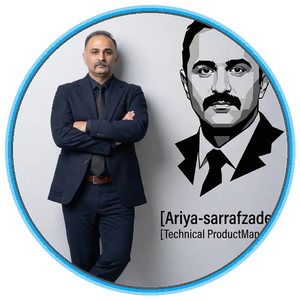
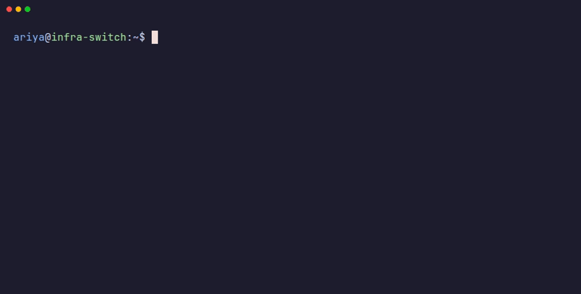
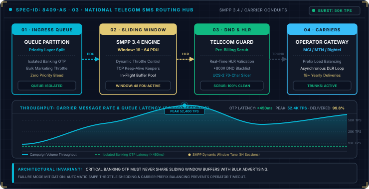
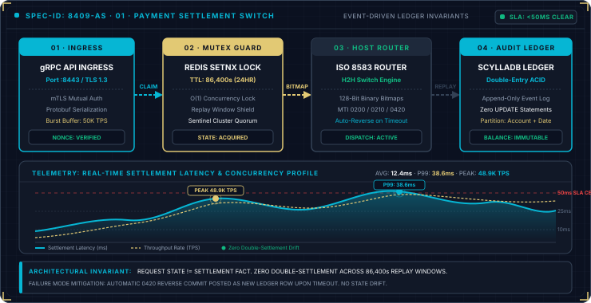
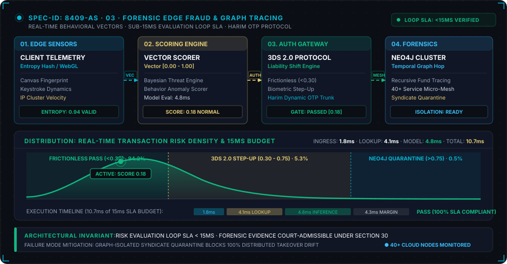
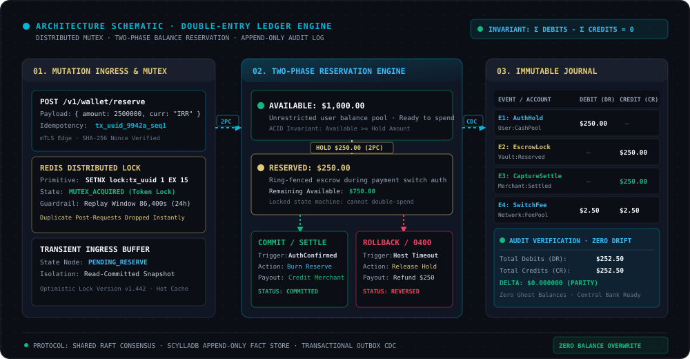
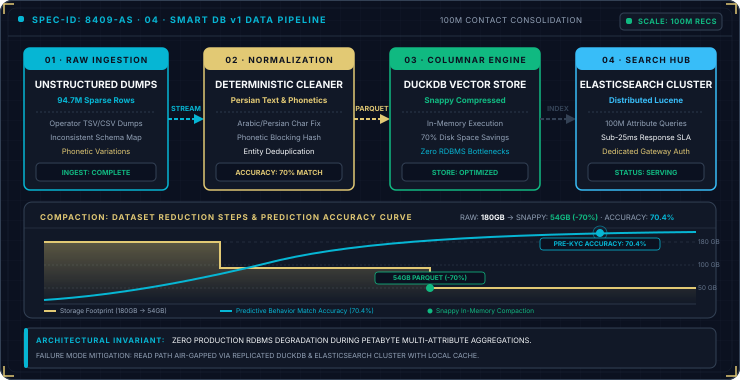
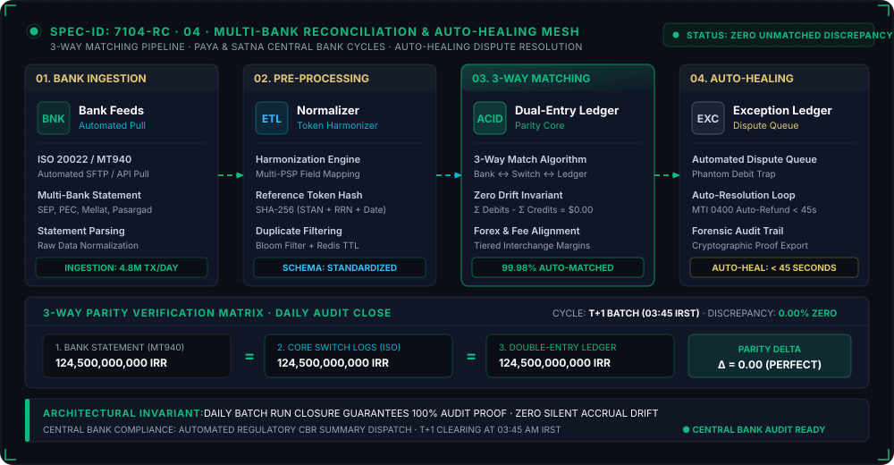

  

  

  <b>I engineer zero-financial-drift state machines, sub-30ms switching rails, and high-throughput telecom switches.</b> 
  Distributed ACID ledgers · ISO 8583 payment switches · SMPP 3.4 telecom windowing · Sub-15ms fraud telemetry

  
  
  
  
  
  
  
  
  
  
  
  
  

  <table>
    <tr>
      <td align="center" width="25%">⚡ <b>Throughput Core</b> <code>50,000+ TPS</code></td>
      <td align="center" width="25%">🛡️ <b>PSP Failover</b> <code>&lt; 30ms SLA</code></td>
      <td align="center" width="25%">🔒 <b>Financial Drift</b> <code>0.00% (2PC Mutex)</code></td>
      <td align="center" width="25%">📡 <b>Edge Fraud Radar</b> <code>&lt; 15ms Telemetry</code></td>
    </tr>
  </table>

<!-- TERMINAL:START -->

  

<!-- TERMINAL:END -->

---

## What I build

- **Zero-drift distributed ledgers.** Strict double-entry state machines, two-phase commit (2PC) reconciliation with Redis `SETNX` distributed locks, and deterministic idempotent pipelines guaranteeing zero financial drift across 50K+ TPS clearing rails.
- **Smart payment switching rails (ISO 8583).** Dynamic multi-rail dispatch, sub-30ms automated PSP failovers, sliding-window throttling, and automated Paya / Satna clearing state machines.
- **High-throughput telecom infrastructure (SMPP 3.4).** Asynchronous queue workers, carrier sliding-window throttling, multi-trunk automated failover, and strict carrier SLA monitoring.
- **Forensic fraud & risk loops.** Real-time multi-hop correlation, national eKYC verification, device telemetry scoring, and sub-15ms edge fraud perimeter enforcement.
- **High-performance analytical pipelines.** Columnar ingestion and enrichment with DuckDB, PyArrow and Parquet, high-cardinality indexing with Elasticsearch, and real-time observability via Prometheus & Grafana.

<b>Capabilities, and the repos that prove them</b>

 

| Capability | Proof |
|---|---|
| **Payment Switching & ISO 8583** (Dynamic multi-rail routing, sub-30ms automated failover, Paya/Satna clearing) | [portfolio](https://github.com/AriyaSrfZ/portfolio) · [sms-gateway-docs](https://github.com/AriyaSrfZ/sms-gateway-docs) |
| **Distributed Ledgers & 2PC Mutex** (Double-entry accounting, Redis SETNX locks, idempotency keys, drift elimination) | [link-shortener](https://github.com/AriyaSrfZ/link-shortener) · [portfolio](https://github.com/AriyaSrfZ/portfolio) |
| **High-Throughput Telecom Switches** (SMPP 3.4 windowing, queue isolation, carrier trunk failover, live telemetry) | [sms-gateway-monitor](https://github.com/AriyaSrfZ/sms-gateway-monitor) · [sms-gateway-sdks](https://github.com/AriyaSrfZ/sms-gateway-sdks) · [sms-gateway-docs](https://github.com/AriyaSrfZ/sms-gateway-docs) |
| **Identity, Auth & Zero-Trust Isolation** (RS256 asymmetric JWTs, JWKS public key distribution, tenant-isolated RBAC) | [identity-service](https://github.com/AriyaSrfZ/identity-service) |
| **Analytical Data Pipelines & Columnar Storage** (DuckDB, PyArrow, Parquet, 94M+ records consolidation) | [data-profiler](https://github.com/AriyaSrfZ/data-profiler) · [data-enrichment](https://github.com/AriyaSrfZ/data-enrichment) |
| **Computer Vision & Document Decoding** (ZBar C engine, PDF multi-page extraction, vector rendering) | [doc-barcode-scanner](https://github.com/AriyaSrfZ/doc-barcode-scanner) |
| **Autonomous Multi-Agent Orchestration & Modeling** (Multi-harness coordination, financial state machines) | [maverick-agent-os](https://github.com/AriyaSrfZ/maverick-agent-os) · [ai-equity-systems](https://github.com/AriyaSrfZ/ai-equity-systems) · [Heretic](https://github.com/AriyaSrfZ/Heretic) |

---

## Flagship Systems & Microservices

<table>
<tr>
<td width="50%" valign="top">

<h3><a href="https://github.com/AriyaSrfZ/sms-gateway-monitor">sms-gateway-monitor</a></h3>
Real-time availability, DNS resolution, and latency monitoring suite testing carrier gateways across distributed regional networks and Anycast resolvers.
  
Multi-carrier DNS probing · automated route failover alerts · latency benchmarking · Discord/ntfy hooks 
<b>Go · Python · PostgreSQL · Chart.js · Docker</b>
</td>
<td width="50%" valign="top">

<h3><a href="https://github.com/AriyaSrfZ/portfolio">portfolio · Systems Blueprint</a></h3>
Architectural blueprint and production switch engine: idempotent transaction log, two-phase commit (2PC) reconciliation, and double-entry ledger immutability.
  
ISO 8583 message parsing · Outbox pattern · Redis SETNX mutex · ScyllaDB ledger immutability · Sub-30ms automated failover 
<b>Astro · React 18 · TypeScript · ScyllaDB · Redis</b>
</td>
</tr>
<tr>
<td width="50%" valign="top">

<h3><a href="https://github.com/AriyaSrfZ/identity-service">identity-service</a></h3>
Standalone zero-trust authentication and multi-tenant user management microservice issuing RS256 asymmetric JWTs with local offline verification.
  
RS256 asymmetric signatures · JWKS public key distribution · tenant-isolated RBAC · Bcrypt auth 
<b>Python · FastAPI · Cryptography · PostgreSQL · Redis · Docker</b>
</td>
<td width="50%" valign="top">

<h3><a href="https://github.com/AriyaSrfZ/link-shortener">link-shortener</a></h3>
Lightweight, self-hosted URL shortener with UTM campaign tracking, offline click geolocation, device telemetry analytics, and multi-tenant account isolation.
  
Base62 custom slugs · offline GeoIP2 lookup · Chart.js analytics · multi-tenant customer scoping 
<b>Python · FastAPI · SQLAlchemy · SQLite · PostgreSQL · Chart.js</b>
</td>
</tr>
<tr>
<td width="50%" valign="top">

<h3><a href="https://github.com/AriyaSrfZ/data-profiler">data-profiler</a></h3>
Columnar dataset profiling and anomaly detection pipeline consolidating 94M+ records into high-density Parquet datastores with sub-second DuckDB query gateways.
  
Out-of-core columnar scans · null density scoring · schema drift verification · automated reporting 
<b>Python · DuckDB · Apache Arrow · Parquet · FastAPI</b>
</td>
<td width="50%" valign="top">

<h3><a href="https://github.com/AriyaSrfZ/doc-barcode-scanner">doc-barcode-scanner</a></h3>
Dual-engine service for scanning, localizing, and decoding barcodes from pictures and multi-page PDF documents, paired with 1D/2D generator and interactive canvas studio.
  
ZBar C engine · spatial bounding-box localization · PDF page extraction · SVG/PNG vector rendering 
<b>Python · FastAPI · Pillow · pyzbar · pypdf · Canvas</b>
</td>
</tr>
</table>

---

## More Systems & Microservices

<table>
<tr>
<td width="33%" valign="top">
<b><a href="https://github.com/AriyaSrfZ/sms-gateway-sdks">sms-gateway-sdks</a></b> 
Idiomatic client SDKs across 10 programming languages for telecommunication gateways.
</td>
<td width="33%" valign="top">
<b><a href="https://github.com/AriyaSrfZ/data-enrichment">data-enrichment</a></b> 
High-performance columnar enrichment pipeline and querying gateway on DuckDB and FastAPI.
</td>
<td width="33%" valign="top">
<b><a href="https://github.com/AriyaSrfZ/maverick-agent-os">maverick-agent-os</a></b> 
Autonomous multi-harness agent orchestration framework connecting browser automation and session state.
</td>
</tr>
<tr>
<td width="33%" valign="top">
<b><a href="https://github.com/AriyaSrfZ/wordpress-sms-gateway">wordpress-sms-gateway</a></b> 
WordPress plugin integrating unified SMS gateway transport drivers into WP SMS and WooCommerce.
</td>
<td width="33%" valign="top">
<b><a href="https://github.com/AriyaSrfZ/sms-gateway-docs">sms-gateway-docs</a></b> 
OpenAPI specifications, payload schemas, and Postman workspaces for enterprise messaging web services.
</td>
<td width="33%" valign="top">
<b><a href="https://github.com/AriyaSrfZ/ai-equity-systems">ai-equity-systems</a></b> 
Autonomous multi-agent execution pipelines for quantitative financial models and state verification.
</td>
</tr>
</table>

<b>Off the clock: High-Performance Simulation & 3D Web Engines</b>

 
Experimenting with browser-based WebGL/WebGPU physics engines, spatial rendering, orbital Kepler solvers, and arcade mechanics rendered directly on the browser canvas.

All architecture blueprints represent high-throughput systems designed for production auditability. Open any repo for technical specs and runbooks.

### 🕹️ Commit arcade

<!-- ARCADE:START -->
<picture>
  <source media="(prefers-color-scheme: dark)" srcset="./assets/arcade/breakout-contribution-graph-dark.svg">
  <source media="(prefers-color-scheme: light)" srcset="./assets/arcade/breakout-contribution-graph.svg">
  
</picture>

My last year of commits as Breakout bricks, regenerated daily. <a href="https://abozanona.github.io/pacman-contribution-graph/">Play it yourself</a> · made with <a href="https://github.com/abozanona/pacman-contribution-graph">pacman-contribution-graph</a>

<!-- ARCADE:END -->

  

---

### Engineering & Contact Links
- 🌐 **Production Blueprint**: [ariya-sarrafzadeh.ir](https://ariya-sarrafzadeh.ir/)
- 💼 **LinkedIn**: [linkedin.com/in/ariya-sarrafzadeh](https://linkedin.com/in/ariya-sarrafzadeh)
- 📬 **Direct Contact**: [ariasg2002@gmail.com](mailto:ariasg2002@gmail.com)
